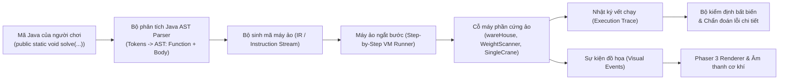

# Kiến Trúc Hệ Thống: Sắp Xếp Kho Hàng Tự Động (AlgoWarehouse)

```yaml
DOCUMENT_ID: DOC-ARCHITECTURE
DOCUMENT_TYPE: ARCHITECTURE
STATUS: CONFIRMED
LAST_UPDATED: 2026-10-17
OWNER: Human & AI
SPRINT: SPRINT-002
```

---

## 1. Mục Tiêu Kiến Trúc Cốt Lõi (Architectural Goals)

1. **Tách biệt hoàn toàn Lõi Thuật toán & Máy ảo khỏi Giao diện đồ họa (Headless-Ready)**:
   - Toàn bộ cơ chế phân tích mã Java, máy ảo thực thi bước lệnh (virtual sandbox) và bộ kiểm định bất biến thuật toán (invariant validator) là thuần TypeScript/JavaScript, không phụ thuộc vào DOM, React hay Phaser 3.
   - Cho phép chạy tự động 100% kiểm thử trên dòng lệnh (Vitest / Node.js).
2. **Mô hình máy ảo ngắt bước an toàn (Step-Yielding Virtual Machine)**:
   - Trình thông dịch Java chạy an toàn, phát ra các sự kiện hành động cơ học (`MachineCommandEvent`).
   - Hỗ trợ hàm Java chuẩn `public static void solve(...)` với cơ chế tiêm phụ thuộc (Dependency Injection) các cỗ máy ảo (`wareHouse`, `WeightScanner`, `SingleCrane`) vào scope thực thi.
   - Cho phép tua từng bước (Step), tạm dừng (Pause), điều chỉnh tốc độ hoặc tua ngược (Time Travel / State Snapshot) mà không bao giờ làm đơ giao diện trình duyệt.
3. **Cơ chế công cụ máy móc phân tách theo chức năng (Single Responsibility Components)**:
   - Các cỗ máy (`WeightScanner`, `SingleCrane`, `Lifter`, `Conveyor`, `CountBins`, `BinaryRack`) được định nghĩa độc lập dưới dạng các Adapter điều khiển phần cứng ảo.
   - Mỗi màn chơi định nghĩa cấu hình cấp phát (Provisioning Spec) để chỉ nạp đúng tập công cụ "Đủ - Không Dư - Không Thiếu".
4. **Kiểm định hai lớp chống gian lận & Chẩn đoán lỗi ngữ cảnh (Dual-Layer Anti-Cheat & Diagnostic Feedback)**:
   - *Lớp 1 (Execution Trace Invariant)*: Theo dõi chuỗi hành vi thực tế trong quá trình chạy, bắt lỗi ngữ cảnh với số dòng code vi phạm.
   - *Lớp 2 (Hidden Test Suite Validation)*: Tự động chạy lại mã trên nhiều mảng ẩn đầu vào (reverse, sorted, duplicates, random).
5. **Kiến trúc Giao diện & Điều hướng phân tầng (App Shell & Routing)**:
   - Header cố định, Trang Home giới thiệu dự án và catalog màn chơi, Màn chơi chi tiết với bố cục split-screen (Code Editor + Phaser Canvas).

---

## 2. Mô Hình Phân Tầng & Chiều Phụ Thuộc (Layering & Dependency Direction)

```
┌────────────────────────────────────────────────────────┐
│  Tầng 1: App Shell & Routing (React 19)                │
│  - Header Navigation, Trang Home, Level Registry       │
│  - Code Editor (Monaco + Format Code), Diagnostic HUD  │
└───────────────────────────┬────────────────────────────┘
                            │ (gửi code, chọn màn, trigger chạy)
                            ↓
┌────────────────────────────────────────────────────────┐
│  Tầng 2: Game Simulation & Presentation (Phaser 3)     │
│  - Render hoạt ảnh nhiều cỗ máy (Scanner, Crane,...)   │
│  - Đồng bộ khung hình (FPS) theo nhịp sự kiện máy ảo   │
└───────────────────────────┬────────────────────────────┘
                            │ (nhận event, query trạng thái)
                            ↓
┌────────────────────────────────────────────────────────┐
│  Tầng 3: Virtual Machine & Invariant Validator         │
│  - Bộ phân tích cú pháp Java (Java AST Parser + solve) │
│  - Máy ảo thực thi lệnh ảo (Step-by-step Runner)       │
│  - Bộ kiểm định bất biến & sinh chẩn đoán lỗi chi tiết │
└───────────────────────────┬────────────────────────────┘
                            │ (gọi hàm phần cứng ảo)
                            ↓
┌────────────────────────────────────────────────────────┐
│  Tầng 4: Domain Core & Machine Hardware Model          │
│  - Trạng thái kho hàng (thùng hàng có id & weight)     │
│  - Cỗ máy độc lập: wareHouse, WeightScanner,           │
│    SingleCrane, Lifter, CountBins, BinaryRack          │
└────────────────────────────────────────────────────────┘
```

**Quy tắc bất biến**:
- Chiều phụ thuộc nghiêm ngặt một chiều từ trên xuống dưới ($1 \to 2 \to 3 \to 4$).
- Tầng dưới tuyệt đối **KHÔNG ĐƯỢC** import hoặc gọi ngược lên tầng trên.
- Tầng 3 và 4 hoàn toàn không chứa mã liên quan đến Canvas, WebGL, DOM hay Phaser.

---

## 3. Đường Ống Xử Lý Lệnh Java (Java Execution Pipeline)



1. **Phân tích cú pháp (Parser)**: Đọc mã Java người chơi viết trong editor, nhận diện phương thức `public static void solve(...)`, xác thực tham số, hỗ trợ biến, `boolean`, toán tử so sánh, `if/else`, vòng lặp `for`/`while`, và `break`.
2. **Tiêm phụ thuộc & Khởi tạo Scope**: Nạp các instance máy móc ảo (`wareHouse`, `weightScanner`, `singleCrane`) vào scope thực thi của hàm `solve`.
3. **Biên dịch trung gian & Ngắt bước (Step Yielding)**: Thực thi từng bước lệnh cơ học (`SCANNER_READ`, `SCANNER_MOVE`, `CRANE_SWAP`, `CRANE_MOVE`, `CRANE_MOVESTART`), phát sự kiện tương ứng.
4. **Kiểm định bất biến & Báo lỗi chi tiết**: Nếu có vi phạm (sai thuật toán, hoán đổi không liền kề, thứ tự khối lượng không tăng dần), hệ thống báo chi tiết dòng code và nội dung vi phạm.
5. **Đồng bộ đồ họa đa máy móc**: Phaser 3 hiển thị đồng thời cả `WeightScanner` (quét đèn beam) và `SingleCrane` (cẩu gantry đổi chỗ).

---

## 4. Ranh Giới Module & Tổ Chức Thư Mục

- `src/core/`:
  - `src/core/domain/`: Trạng thái kho hàng, thùng hàng (`id`, `weight`).
  - `src/core/machines/`: Các module cỗ máy tái sử dụng (`WarehouseEnvironment`, `WeightScanner`, `SingleCrane`, `Lifter`,...).
  - `src/core/parser/`: Trình phân tích cú pháp Java sang mã trung gian, hỗ trợ method `solve`.
  - `src/core/vm/`: Máy ảo thực thi bước lệnh và quản lý bộ nhớ/ngăn xếp.
  - `src/core/validator/`: Bộ kiểm tra bất biến thuật toán cho từng màn chơi, sinh chẩn đoán lỗi chi tiết.
- `src/game/`: Tầng đồ họa Phaser 3 (WarehouseScene, Sprites máy móc, Animations, Sound FX).
- `src/components/`: Tầng giao diện React 19 (Header, Playback Controls, Diagnostic Modal, Level Navigation).
- `src/pages/`: Các trang chính (HomePage, LevelPage, TutorialPage).
- `src/test/`: Bộ kiểm thử tự động Vitest cho toàn bộ logic lõi và thuật toán.

