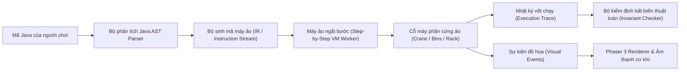

# Kiến Trúc Hệ Thống: Sắp Xếp Kho Hàng Tự Động (AlgoWarehouse)

```yaml
DOCUMENT_ID: DOC-ARCHITECTURE
DOCUMENT_TYPE: ARCHITECTURE
STATUS: CONFIRMED
LAST_UPDATED: 2026-10-16
OWNER: Human & AI
SPRINT: SPRINT-000
```

---

## 1. Mục Tiêu Kiến Trúc Cốt Lõi (Architectural Goals)

1. **Tách biệt hoàn toàn Lõi Thuật toán & Máy ảo khỏi Giao diện đồ họa (Headless-Ready)**:
   - Toàn bộ cơ chế phân tích mã Java, máy ảo thực thi bước lệnh (virtual sandbox) và bộ kiểm định bất biến thuật toán (invariant validator) là thuần TypeScript/JavaScript, không phụ thuộc vào DOM, React hay Phaser 3.
   - Cho phép chạy tự động 100% kiểm thử trên dòng lệnh (Vitest / Node.js).
2. **Mô hình máy ảo ngắt bước an toàn (Step-Yielding Virtual Machine)**:
   - Trình thông dịch Java chạy trên Web Worker hoặc generator (`yield`), phát ra các sự kiện hành động cơ học (`MachineCommandEvent`).
   - Nhờ đó, người chơi có thể tua từng bước (Step), tạm dừng (Pause), điều chỉnh tốc độ hoặc tua ngược (Time Travel / State Snapshot) mà không bao giờ làm đơ giao diện trình duyệt.
3. **Cơ chế công cụ máy móc dạng Module tái sử dụng (Composable Machine Components)**:
   - Các cỗ máy (`crane`, `conveyor`, `scanner`, `lifter`, `rack`, `bucket`) được định nghĩa độc lập dưới dạng các Adapter điều khiển phần cứng ảo.
   - Mỗi màn chơi định nghĩa cấu hình cấp phát (Provisioning Spec) để chỉ nạp đúng tập công cụ "Đủ - Không Dư - Không Thiếu".
4. **Kiểm định hai lớp chống gian lận (Dual-Layer Anti-Cheat)**:
   - *Lớp 1 (Execution Trace Invariant)*: Theo dõi chuỗi hành vi thực tế trong quá trình chạy.
   - *Lớp 2 (Hidden Test Suite Validation)*: Tự động chạy lại mã trên nhiều mảng ẩn đầu vào (reverse, sorted, duplicates, random).

---

## 2. Mô Hình Phân Tầng & Chiều Phụ Thuộc (Layering & Dependency Direction)

```
┌────────────────────────────────────────────────────────┐
│  Tầng 1: Application & UI (React 19 / Monaco Editor)   │
│  - Bảng điều khiển, Code Editor, HUD, Nút Play/Step    │
└───────────────────────────┬────────────────────────────┘
                            │ (gửi code, lắng nghe state)
                            ↓
┌────────────────────────────────────────────────────────┐
│  Tầng 2: Game Simulation & Presentation (Phaser 3)     │
│  - Render hoạt ảnh cần cẩu, thùng hàng, băng chuyền     │
│  - Đồng bộ khung hình (FPS) theo nhịp sự kiện máy ảo   │
└───────────────────────────┬────────────────────────────┘
                            │ (nhận event, query trạng thái)
                            ↓
┌────────────────────────────────────────────────────────┐
│  Tầng 3: Virtual Machine & Invariant Validator         │
│  - Bộ phân tích cú pháp Java (Java AST Parser)         │
│  - Máy ảo thực thi lệnh ảo (Step-by-step Runner)       │
│  - Bộ giám sát bất biến thuật toán (Trace Validator)   │
└───────────────────────────┬────────────────────────────┘
                            │ (gọi hàm phần cứng ảo)
                            ↓
┌────────────────────────────────────────────────────────┐
│  Tầng 4: Domain Core & Machine Hardware Model          │
│  - Trạng thái mảng số liệu kho hàng (Array State)      │
│  - Các cỗ máy module hóa (Crane, Lifter, Bins, Rack)   │
└────────────────────────────────────────────────────────┘
```

**Quy tắc bất biến**:
- Chiều phụ thuộc nghiêm ngặt một chiều từ trên xuống dưới ($1 \to 2 \to 3 \to 4$).
- Tầng dưới tuyệt đối **KHÔNG ĐƯỢC** import hoặc gọi ngược lên tầng trên.
- Tầng 3 và 4 hoàn toàn không chứa mã liên quan đến Canvas, WebGL, DOM hay Phaser.

---

## 3. Đường Ống Xử Lý Lệnh Java (Java Execution Pipeline)



1. **Phân tích cú pháp (Parser)**: Đọc mã Java người chơi viết trong editor, kiểm tra tính hợp lệ về cú pháp của vòng lặp (`for`, `while`), điều kiện (`if`, `else`), biến số, và các lệnh gọi đối tượng được cấp phát.
2. **Biên dịch trung gian (Intermediate Representation)**: Chuyển đổi mã thành chuỗi lệnh máy ảo có thể tạm dừng/tiếp tục (`STEP_NEXT`, `STEP_COMPARE`, `STEP_SWAP`,...).
3. **Thực thi trên Worker**: Chạy an toàn trong Web Worker, áp dụng `Step Budget` (ngăn vòng lặp vô tận) và ghi nhận toàn bộ lịch sử thao tác (`Execution Trace`).
4. **Kiểm định bất biến**: Đối chiếu `Execution Trace` với các điều kiện tiên quyết của thuật toán tương ứng ở màn chơi đó.
5. **Đồng bộ đồ họa**: Phaser 3 nhận luồng sự kiện để diễn hoạt cẩu di chuyển, thùng hàng nhấc lên, đổi chỗ với tốc độ mượt mà 60 FPS.

---

## 4. Ranh Giới Module & Tổ Chức Thư Mục

- `src/core/`:
  - `src/core/domain/`: Trạng thái kho hàng, thùng hàng, dữ liệu mảng.
  - `src/core/machines/`: Các module cỗ máy tái sử dụng (`Crane`, `Lifter`, `Conveyor`, `CountBins`, `BinaryRack`,...).
  - `src/core/parser/`: Trình phân tích cú pháp Java sang mã trung gian.
  - `src/core/vm/`: Máy ảo thực thi bước lệnh và quản lý bộ nhớ/ngăn xếp.
  - `src/core/validator/`: Bộ kiểm tra bất biến thuật toán cho từng màn chơi và chạy test ẩn.
- `src/game/`: Tầng đồ họa Phaser 3 (Scenes, Sprites, Animations, Sound FX).
- `src/components/`: Tầng giao diện React 19 (Code Editor, Playback Controls, Campaign Map, HUD).
- `src/test/`: Bộ kiểm thử tự động Vitest cho toàn bộ logic lõi và thuật toán.
